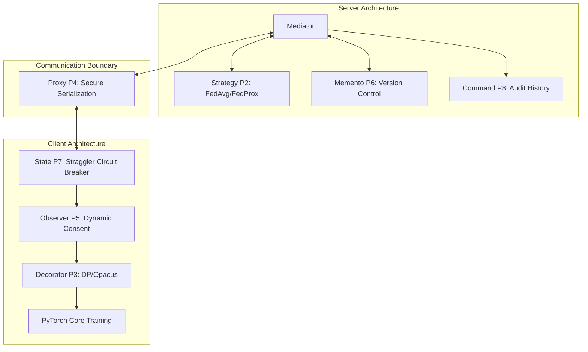
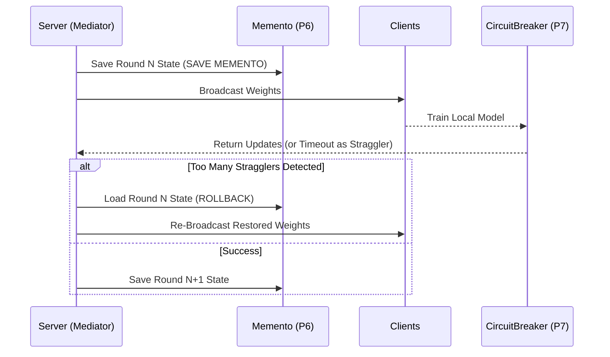

# Patternized Federated Learning for Medical Imaging

A structured, modular, and maintainable approach to Federated Learning (FL) using Gang of Four (GoF) Design Patterns. This project addresses the critical complexities of deploying FL in medical imaging: handling high data heterogeneity (non-IID data), ensuring rigorous privacy compliance (Differential Privacy & GDPR/HIPAA), and managing system resilience (straggler mitigation and rollbacks) without entangling the codebase.

---

## Table of Contents
1. [Project Overview](#project-overview)
2. [Architectural Structure](#architectural-structure)
3. [GoF Design Patterns Catalog](#gof-design-patterns-catalog)
4. [File Structure](#file-structure)
5. [Experimental Results](#experimental-results)
6. [Getting Started & Installation](#getting-started--installation)
7. [Running the Experiments](#running-the-experiments)

---

## Project Overview

Standard FL deployments in healthcare suffer from monolithic architectures where training loops, aggregation strategies, privacy accountants, and connection handlers are tightly coupled. This codebase systematically applies **8 Gang of Four (GoF) Design Patterns** to cleanly separate these cross-cutting concerns.

**Key Features:**
- **Strict Modularity**: Core logic remains isolated; patterns are composed incrementally.
- **Regulatory Compliance by Design**: Direct structural mapping to GDPR and HIPAA constraints.
- **Differential Privacy (DP)**: Integrated seamlessly using Opacus.
- **Resilience**: Graceful handling of stragglers and deterministic model rollbacks via Memento and Circuit Breaker semantics.

---

## Architectural Structure

The system is decoupled using an event-driven `Mediator` that connects the Server, Clients, Privacy Decorators, and Resilience Observers.

### 1. High-Level Flow (Mermaid Diagram)



### 2. The Rollback Mechanism (Sequence Diagram)



---

## GoF Design Patterns Catalog

This framework maps classic software engineering patterns directly to FL features and regulatory requirements:

| Pattern | Component | Purpose & Compliance Mapping |
| :--- | :--- | :--- |
| **P1: Mediator** | Control Flow | Centralizes event dispatching, acting as a deliberate complexity sink to keep domain logic clean. |
| **P2: Strategy** | Aggregation | Dynamically swaps FL aggregation algorithms (e.g., FedAvg vs. FedProx). |
| **P3: Decorator** | Differential Privacy | Wraps PyTorch loops to inject DP (via Opacus). **Maps to GDPR Art. 25** (Data Protection by Design). |
| **P4: Proxy** | Communication | Manages secure object serialization across the network barrier. **Maps to GDPR Art. 32** (Security). |
| **P5: Observer** | Consent Tracking | Asynchronously tracks dynamic patient consent revocation. **Maps to Dynamic Consent**. |
| **P6: Memento** | Versioning | Captures global model state allowing safe rollbacks. |
| **P7: State** | Straggler Mitigation | Implements a per-client Circuit Breaker (`CLOSED` → `OPEN` → `HALF-OPEN`) to isolate anomalies. |
| **P8: Command** | Audit Logging | Immutable audit history of system events. **Maps to GDPR Art. 30** (Records of Processing Activities). |

---

## File Structure

```text
fedpatterns-med/
├── baselines/                      # Monolithic baseline implementations (B1, B2, B3)
├── configs/                        # YAML configurations for datasets, privacy, and clients
├── fedpatterns/                    # Core Patternized Library (B4)
│   ├── core/                       # Core FL domain and abstract interfaces
│   ├── datasets/                   # Loaders for PneumoniaMNIST and ChestMNIST
│   ├── patterns/                   # GoF Pattern Implementations (P1-P8)
│   │   ├── command/                # P8: Audit History
│   │   ├── decorator/              # P3: DP Decorator
│   │   ├── mediator/               # P1: Event Mediator
│   │   ├── observer/               # P5: Consent Observer
│   │   ├── prototype/              # P6: Memento/Versioned State
│   │   ├── proxy/                  # P4: Secure Proxy
│   │   └── strategy/               # P2: FedAvg / FedProx strategies
│   ├── privacy/                    # DP policy calculators and Opacus integration
│   └── resilience/                 # Straggler circuit breakers (P7)
├── scripts/                        # Utility bash scripts
├── experiments/                    # MLflow run orchestration code
├── paper.tex                       # Generated LaTeX paper draft
└── run_e*_*.sh                     # Runnable experiment bash scripts
```

---

## Experimental Results

Our extensive evaluation on **PneumoniaMNIST** and **ChestMNIST** datasets yields the following canonical results:

### 1. Architectural Complexity (Cyclomatic Complexity)
Patternization deliberately shifts complexity into the Mediator (7.62 CC) while simplifying individual component layers significantly compared to the standard B1 Monolith.
- **B1 Monolith**: 3.13 CC
- **B4 Patternized (Strategy Layer)**: 1.50 CC
- **B4 Patternized (Individual Patterns)**: 2.77 CC

### 2. Differential Privacy Trade-Off
The architecture demonstrates extreme robustness to Differential Privacy noise scaling.
- **$\epsilon = 20.75$ (nm=0.5)**: 0.7099 Accuracy
- **$\epsilon = 8.396$ (nm=1.0)**: 0.7099 Accuracy
- **$\epsilon = 3.86$ (nm=1.5)**: 0.6250 Accuracy
> *Finding: The model maintains utility across a massive privacy jump, degrading only at the strictest settings.*

### 3. Non-IID Dataset Scaling (ChestMNIST AUC-ROC)
Even under severe Non-IID data distribution ($\alpha=0.1, 0.5, 1.0$), the Patternized architecture (B4) performs precisely on par with the standard B1 Monolith (within 0.005 AUC-ROC variance).

| $\alpha$ | B1 (FedAvg Monolith) | B2 (FedProx Monolith) | B4 (Patternized Ours) |
| :--- | :--- | :--- | :--- |
| **0.1** | 0.6873 | 0.6732 | 0.6827 |
| **0.5** | 0.6795 | 0.6674 | 0.6799 |
| **1.0** | 0.6705 | 0.6640 | 0.6706 |

### 4. Resilience and Rollback Execution
When hit with a 30% straggler drop in Round 2, the system's `State` circuit breaker detects the anomaly, and the `Memento` triggers a rollback, dropping the Val Loss from an exploding `1.389` back to a stable `0.653` by Round 3.

---

## Getting Started & Installation

To run this project from scratch after pulling the repo, follow these steps:

### 1. Prerequisites
- Linux / Ubuntu / WSL2
- Conda or Miniconda installed
- NVIDIA GPU (Optional but recommended for fast PyTorch training)

### 2. Environment Setup
Create and activate the designated Conda environment.
```bash
conda create -n fedpatterns-med python=3.10 -y
conda activate fedpatterns-med
```

### 3. Install Dependencies
```bash
pip install -r requirements.txt
# Alternatively, if installing as an editable package:
pip install -e .
```

### 4. Bootstrapping MLflow
We use MLflow to track all experimental runs, parameters, and metrics.
```bash
# In a separate terminal session, start the MLflow UI:
conda activate fedpatterns-med
mlflow ui --port 5000
```
You can view live metrics by navigating to `http://localhost:5000` in your web browser.

---

## Running the Experiments

The repository includes pre-configured bash scripts for running all Milestone experiments exactly as reported in the paper. 

### Experiment 1: Run Differential Privacy Scenarios
To test the DP-Accuracy trade-off (E2):
```bash
# Set DP noise multipliers and execute the DP runs
./run_e2_nm05_pure.sh
```

### Experiment 2: Run Non-IID Dataset Scaling
To run the Non-IID scaling experiment across $\alpha \in \{0.1, 0.5, 1.0\}$ for baselines B1, B2, and B4:
```bash
# Execute standard baselines
./run_e3_b1_b2_only.sh

# Execute patternized architecture (B4)
./run_e3_b4_only.sh
```

### Experiment 3: Evaluate System Resilience (Straggler Mitigation)
To simulate stragglers and observe the automatic Memento rollback mechanism:
```bash
export FED_ENABLE_STRAGGLER="True"
export FED_EXPERIMENT_NAME="M6-E4-Resilience"
# Run the patternized baseline directly
python baselines/b4_patternized/run_b4.py
```

---

## Contributing & Extending
The highly decoupled nature of the GoF patterns makes it trivial to swap out modules. To add a new aggregation algorithm, simply create a new class implementing the `IStrategy` interface in `fedpatterns/patterns/strategy/` without touching the training loops or privacy components.
