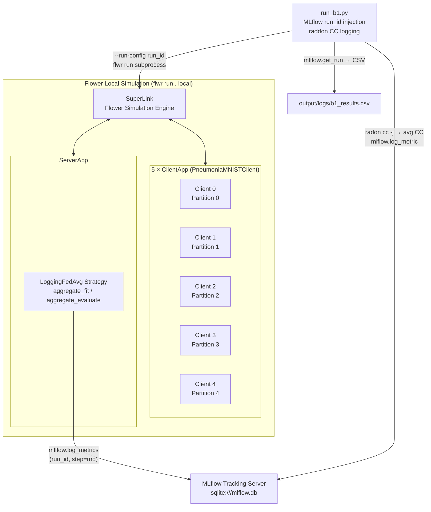

# M1 Raw Architecture — Vanilla B1 Baseline

> **"Before" diagram** — the unpatternized B1 system.
> This will be directly contrasted against the patternized M2 architecture in the paper's maintainability narrative.

## System Component Diagram

## Component Responsibilities (M1)

| Component | Role | Notes |
|---|---|---|
| `run_b1.py` | Entry point; opens MLflow run; injects `run_id` via env var; runs radon; saves CSV | Directory-agnostic via `pathlib` |
| `SuperLink` | Flower simulation engine — routes messages between clients and server | Managed by `flwr run` |
| `ClientApp` (×5) | Local training with mixed-precision (`torch.cuda.amp`); Dirichlet partition | Reads `partition-id` from `Context` |
| `LoggingFedAvg` | FedAvg aggregation; per-round MLflow logging in `aggregate_fit`/`aggregate_evaluate` | Uses `mlflow.log_metrics(..., run_id=..., step=rnd)` |
| `MLflow` | Tracks all metrics: ML (accuracy, loss, F1), FL system (timing, comm bytes), privacy (ε=∞), resilience (zeros) | Single run per execution |

## Known Complexity (to be reduced in M2)

- `LoggingFedAvg` has two responsibilities: aggregation **and** observability logging.
  In M2, observability will be extracted into a separate pattern (P5 ConsentObserver / P8 RoundCommandHistory).
- No DP noise (P3), no consent gating (P5), no rollback (P6/P8), no straggler handling (P7).
  All will be layered in via patterns in M2+.

---
*Generated: M1 milestone. Update before M2 by running the architecture diagram script.*
