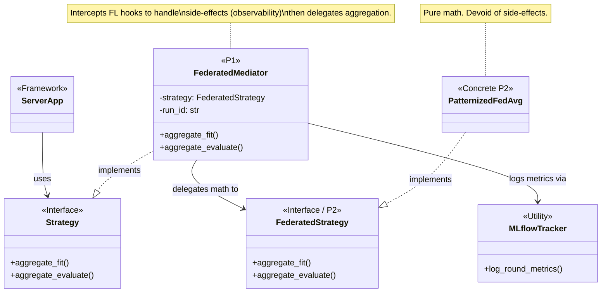

# M2 Patternized Architecture

This diagram illustrates the implementation of the **FederatedMediator (P1)** and **FederatedStrategy (P2)** patterns in Milestone 2. By introducing the Mediator, we successfully decoupled the MLflow observability and orchestration lifecycle from the pure mathematical aggregation (FedAvg).

